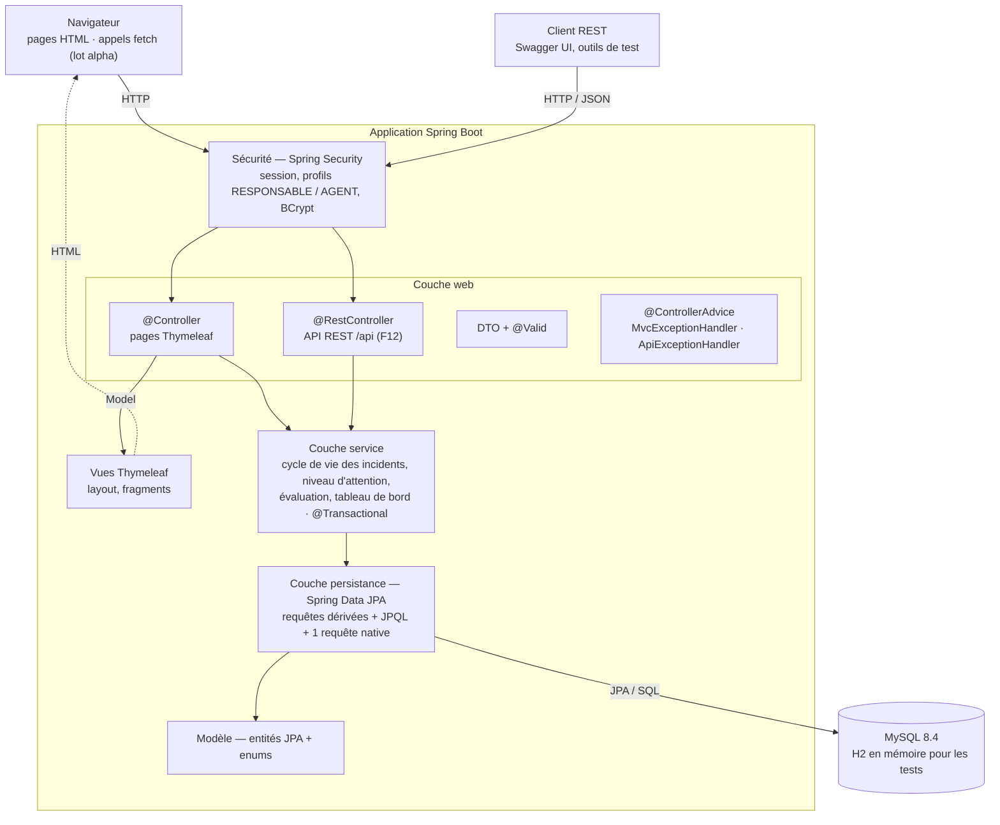
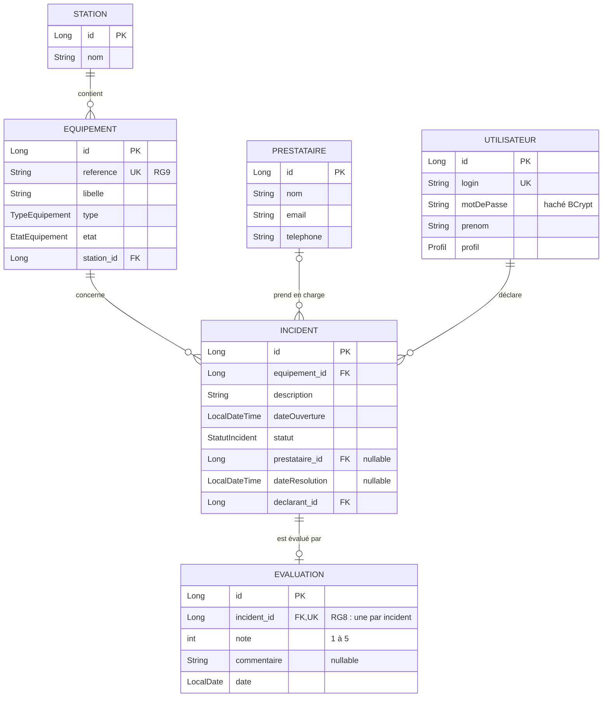
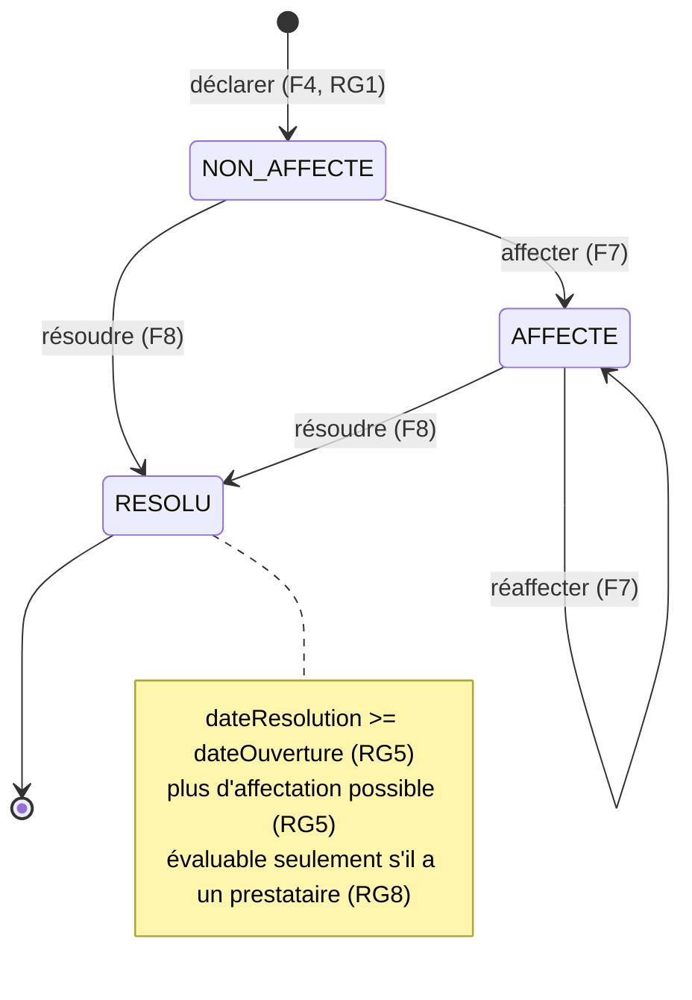
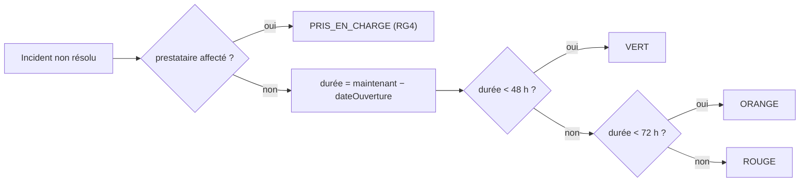
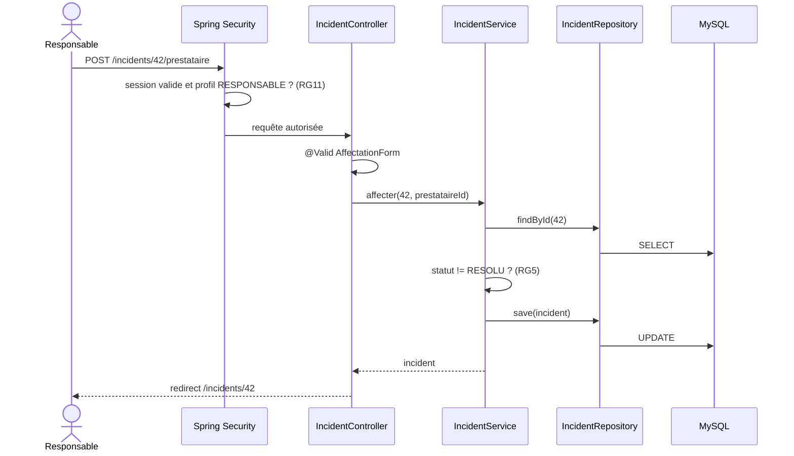
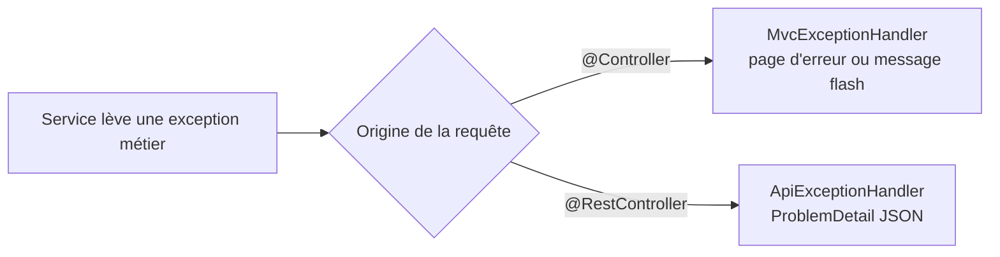
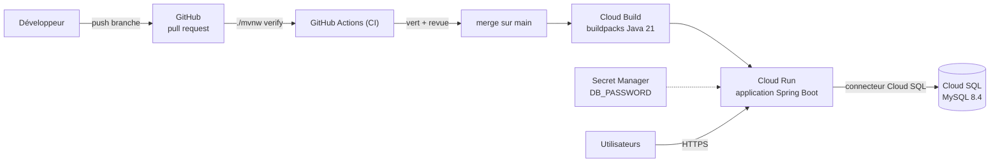

# Architecture — Supervision ALTN72

Ce document décrit l'architecture **cible** de l'application. Il est mis à jour au fil de l'implémentation :
un élément marqué *(à venir)* n'existe pas encore dans le code.

- Dépôt : <https://github.com/ctpnheee/altn72-supervision>
- Pile : Java 21 · Spring Boot 4 (MVC, Data JPA, Security, Validation) · Thymeleaf · MySQL 8.4 · Maven

## 1. Vue d'ensemble en couches

Chaque couche n'appelle que la couche située en dessous. Les règles métier (RG1 à RG10) vivent uniquement
dans la couche service et le modèle, jamais dans les contrôleurs ni dans les vues.



| Couche | Responsabilité | Ne fait jamais |
|---|---|---|
| Sécurité | Authentifier, refuser l'accès selon le profil (RG11) | Contenir de la logique métier |
| Web | Recevoir la requête, valider le DTO, appeler un service, choisir la vue ou le code HTTP | Calculer une règle métier, appeler un repository |
| Service | Appliquer RG1 à RG10, délimiter les transactions | Connaître HTTP, Thymeleaf ou les DTO web |
| Persistance | Lire et écrire en base | Décider d'une règle métier |
| Modèle | Représenter le domaine, garantir ses invariants simples | Dépendre de Spring MVC |

## 2. Organisation des packages

```
fr.efrei.altn72.supervision
├── config/        SecurityConfig, ClockConfig (bean java.time.Clock), OpenApiConfig
├── model/         Station, Equipement, Incident, Prestataire, Evaluation, Utilisateur
│   └── enums/     TypeEquipement, EtatEquipement, StatutIncident, NiveauAttention, Profil
├── repository/    StationRepository, EquipementRepository, IncidentRepository, …
├── service/       IncidentService, EquipementService, EvaluationService,
│                  TableauDeBordService, NiveauAttentionCalculator
├── exception/     exceptions métier personnalisées (messages en français)
├── web/           contrôleurs MVC, dto/, MvcExceptionHandler
├── api/           contrôleurs REST, dto/, ApiExceptionHandler
└── init/          DemoDataLoader (données de démonstration relatives à l'instant présent)
```

## 3. Modèle de données



Enums :

| Enum | Valeurs |
|---|---|
| `TypeEquipement` | ASCENSEUR, ESCALIER_MECANIQUE, PORTIQUE, DISTRIBUTEUR, ECRAN_INFORMATION |
| `EtatEquipement` | EN_SERVICE, EN_PANNE |
| `StatutIncident` | NON_AFFECTE, AFFECTE, RESOLU (RG2) |
| `NiveauAttention` | VERT, ORANGE, ROUGE, PRIS_EN_CHARGE — **calculé, jamais stocké** |
| `Profil` | RESPONSABLE, AGENT |

## 4. Cycle de vie d'un incident



Toute transition non dessinée (par exemple affecter un incident résolu) lève une
`TransitionInterditeException`, traduite en HTTP 409 par l'API et en message lisible sur les pages.

Les transitions qui modifient plusieurs données sont `@Transactional` (RG10) : déclarer un incident
passe l'équipement `EN_PANNE`, résoudre le dernier incident ouvert le repasse `EN_SERVICE`.

## 5. Niveau d'attention (RG3, RG4)

Calculé à chaque lecture par `NiveauAttentionCalculator`, à partir d'un `Clock` injecté (testable avec
`Clock.fixed`). Les seuils sont deux constantes nommées, définies uniquement dans cette classe.



## 6. Exemple de requête traversant les couches : affecter un prestataire (F7)



## 7. Gestion des erreurs



| Exception | API | Pages |
|---|---|---|
| `RessourceIntrouvableException` (incident, équipement…) | 404 | page « introuvable » |
| Donnée invalide (`MethodArgumentNotValidException`) | 400 | formulaire réaffiché avec messages |
| `TransitionInterditeException`, `EvaluationDejaSaisieException` | 409 | message flash sur la page de l'incident |
| Accès refusé | 403 | page « accès refusé » |
| Non authentifié | 401 | redirection vers `/login` |

Aucune trace technique n'est affichée à l'utilisateur.

## 8. Sécurité

| Ressource | RESPONSABLE | AGENT |
|---|---|---|
| Équipements et fiches (F2, F3) | lecture | lecture |
| Déclarer un incident (F4) | oui | oui |
| Consulter / modifier un incident (F5, F6) | oui | lecture, modification de ses incidents non affectés |
| Affecter, résoudre, évaluer (F7, F8, F10) | oui | interdit |
| Historique (F9) | oui | lecture |
| Tableau de bord (F11) | oui | interdit |
| API `/api/**` (F12) | oui | lecture |

Restrictions appliquées côté serveur par `requestMatchers` dans `SecurityConfig` et `@PreAuthorize` sur
les services ; masquer un bouton dans la vue n'est qu'un confort.

## 9. Déploiement



| Environnement | Base | Configuration |
|---|---|---|
| Poste développeur | MySQL local | valeurs par défaut de `application.properties` |
| Tests et CI | H2 en mémoire | `src/test/resources/application.properties` |
| Production | Cloud SQL | variables d'environnement Cloud Run + Secret Manager |

Procédure complète : [SETUP.md](SETUP.md).
