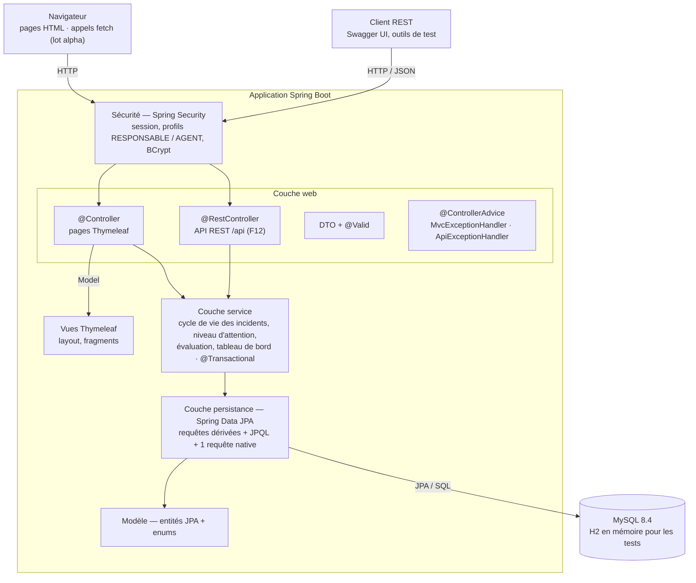
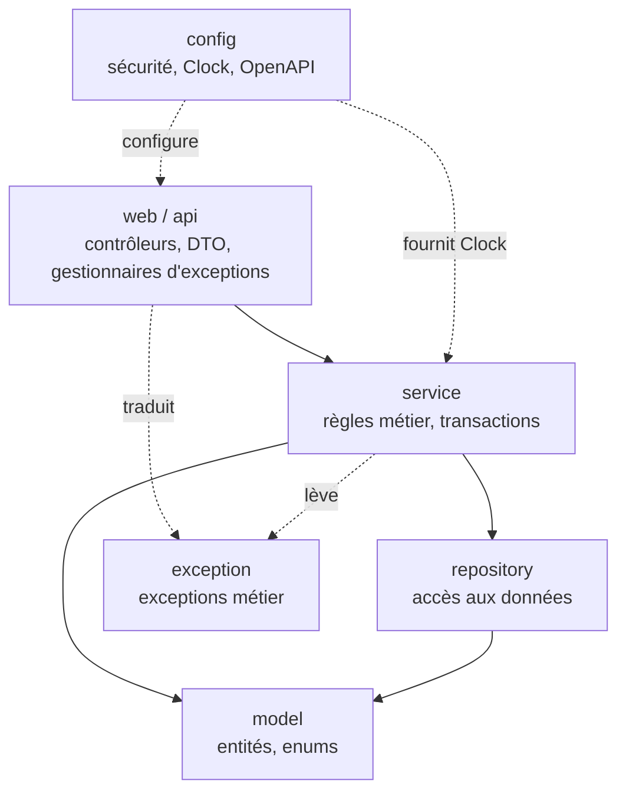
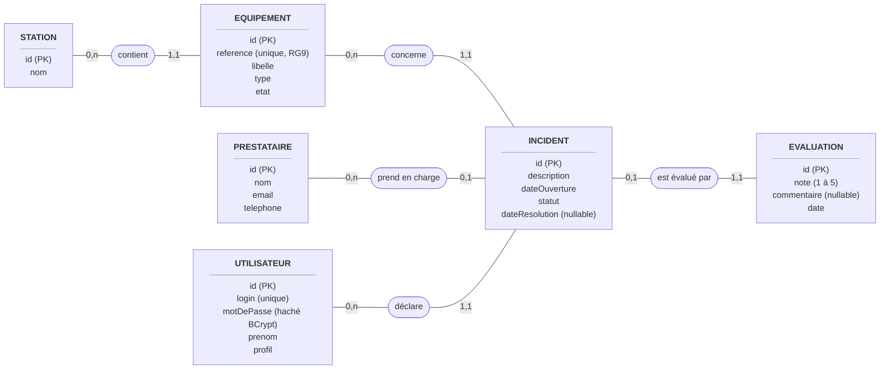
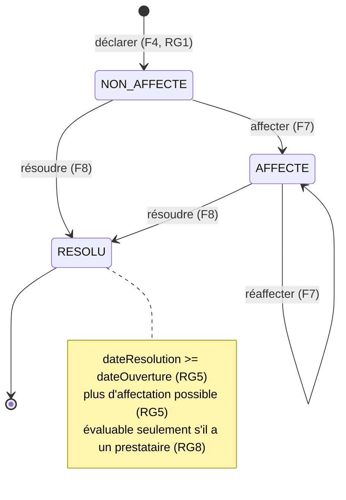
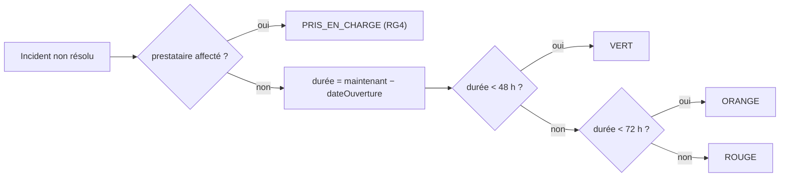
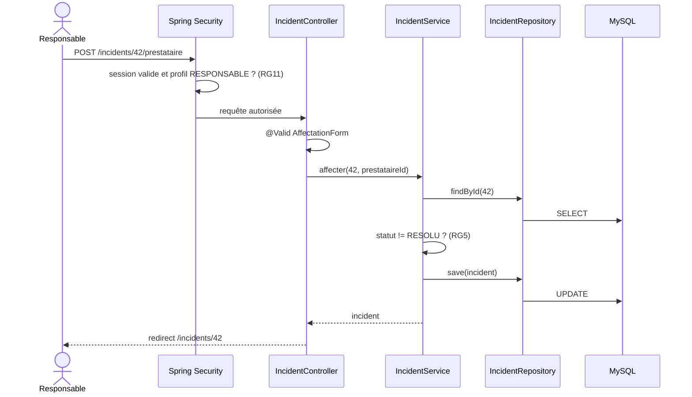
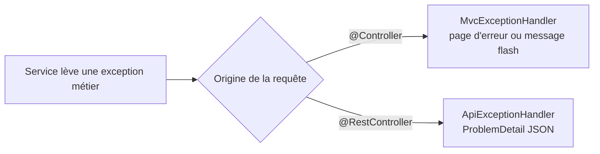
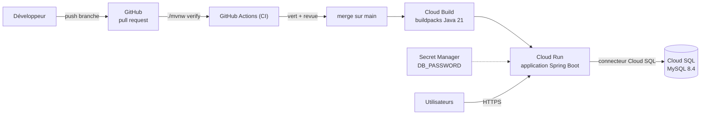

# Architecture — Supervision ALTN72

Ce document décrit l'architecture **cible** de l'application. Il est mis à jour au fil de l'implémentation :
un élément marqué _(à venir)_ n'existe pas encore dans le code.

- Dépôt : <https://github.com/ctpnheee/altn72-supervision>
- Pile : Java 21 · Spring Boot 4 (MVC, Data JPA, Security, Validation) · Thymeleaf · MySQL 8.4 · Maven

## 1. Vue d'ensemble en couches

Chaque couche n'appelle que la couche située en dessous. Les règles métier (RG1 à RG10) vivent uniquement
dans la couche service et le modèle, jamais dans les contrôleurs ni dans les vues.



Le rôle précis de chaque couche est détaillé au §2.

## 2. Séparation des couches et des responsabilités

### 2.1 Règles de dépendance

Les dépendances vont toujours **du haut vers le bas**. Une couche ne connaît que la couche immédiatement
inférieure et le modèle ; elle ignore tout des couches supérieures.



| Autorisé                                             | Interdit                                                                     |
| ---------------------------------------------------- | ---------------------------------------------------------------------------- |
| Contrôleur → service                                 | Contrôleur → repository                                                      |
| Service → repository, modèle, autre service          | Service → `HttpServletRequest`, `Model`, DTO de formulaire, `ResponseEntity` |
| Repository → modèle                                  | Repository → service                                                         |
| Vue → attributs du `Model` fournis par le contrôleur | Vue → calcul d'une règle métier (seuils, transitions)                        |
| Modèle → annotations JPA et validation               | Modèle → Spring MVC, services, repositories                                  |

### 2.2 Rôle de chaque couche

#### Sécurité — `config/SecurityConfig`

|                     |                                                                                                                                             |
| ------------------- | ------------------------------------------------------------------------------------------------------------------------------------------- |
| **Responsabilité**  | Authentifier (formulaire, session), hacher les mots de passe (BCrypt), refuser l'accès selon le profil **avant** toute logique (RG11).      |
| **Composants**      | `SecurityConfig` (`requestMatchers` par profil), `UtilisateurDetailsService`, `@PreAuthorize` sur les méthodes de service sensibles.        |
| **Ne contient pas** | De règle métier : savoir _si_ un incident peut être résolu relève du service, savoir _qui_ a le droit de le demander relève de la sécurité. |
| **Tests**           | MockMvc avec `@WithMockUser` : non connecté → `/login`, AGENT → 403 sur F7, F8, F10, F11.                                                   |

#### Couche web — `web/` (pages) et `api/` (REST)

|                       |                                                                                                                                                                                               |
| --------------------- | --------------------------------------------------------------------------------------------------------------------------------------------------------------------------------------------- |
| **Responsabilité**    | Traduire HTTP en appel métier et le résultat métier en réponse HTTP : lire les paramètres, valider le DTO (`@Valid`), appeler **un** service, choisir la vue, la redirection ou le code HTTP. |
| **Composants**        | `@Controller` (Thymeleaf), `@RestController` (`/api`), DTO de formulaire et de réponse, `MvcExceptionHandler`, `ApiExceptionHandler`.                                                         |
| **Entrées / sorties** | Entrée : requête HTTP. Sortie : nom de vue + `Model`, redirection, ou JSON.                                                                                                                   |
| **Ne contient pas**   | De calcul métier (pas de `if (statut == RESOLU)`), d'appel à un repository, de `try/catch` sur les exceptions métier (traitées par les `@ControllerAdvice`).                                  |
| **Exemple**           | `IncidentController.resoudre(id)` appelle `incidentService.resoudre(id)` puis redirige vers `/incidents/{id}`. La vérification « déjà résolu ? » n'est pas dans le contrôleur.                |
| **Tests**             | MockMvc : statut HTTP, vue rendue, messages de validation, 404 sur ressource inexistante.                                                                                                     |

#### Vues — `templates/`

|                     |                                                                                                                                                                                      |
| ------------------- | ------------------------------------------------------------------------------------------------------------------------------------------------------------------------------------ |
| **Responsabilité**  | Afficher les données reçues et proposer les actions autorisées.                                                                                                                      |
| **Composants**      | `layout.html` (en-tête « Bonjour Prénom (profil) »), fragments, une page par écran.                                                                                                  |
| **Ne contient pas** | De calcul : le niveau d'attention arrive déjà calculé (`VERT`, `ORANGE`…), la vue ne fait que lui associer une couleur CSS. Masquer un bouton est un confort, jamais une protection. |

#### Couche service — `service/`

|                       |                                                                                                                                                                         |
| --------------------- | ----------------------------------------------------------------------------------------------------------------------------------------------------------------------- |
| **Responsabilité**    | Porter **toutes** les règles de gestion RG1 à RG10, orchestrer les repositories, délimiter les transactions (`@Transactional`), lever des exceptions métier explicites. |
| **Composants**        | `IncidentService` (cycle de vie), `EquipementService`, `EvaluationService`, `TableauDeBordService`, `NiveauAttentionCalculator`.                                        |
| **Entrées / sorties** | Entrée : identifiants et valeurs simples. Sortie : entités ou objets de lecture (`IncidentVue`, `IndicateursTableauDeBord`) déjà prêts à afficher.                      |
| **Ne contient pas**   | De notion HTTP, de vue, de DTO de formulaire, de SQL. N'appelle jamais `LocalDateTime.now()` : l'heure vient du `Clock` injecté.                                        |
| **Tests**             | Tests unitaires JUnit avec `Clock.fixed` et repositories simulés : seuils 47 h / 48 h / 72 h, transitions interdites, RG8.                                              |

`spring.jpa.open-in-view=false` : les relations paresseuses ne sont pas chargeables depuis la vue. Le service
renvoie donc des données complètes (requêtes `JOIN FETCH` ou objets de lecture), ce qui garde la frontière nette.

#### Couche persistance — `repository/`

|                     |                                                                                                                                              |
| ------------------- | -------------------------------------------------------------------------------------------------------------------------------------------- |
| **Responsabilité**  | Lire et écrire les entités : requêtes dérivées du nom des méthodes, requêtes JPQL, une requête SQL native.                                   |
| **Composants**      | `StationRepository`, `EquipementRepository`, `IncidentRepository`, `PrestataireRepository`, `EvaluationRepository`, `UtilisateurRepository`. |
| **Ne contient pas** | De décision métier : `findByStatutNot(RESOLU)` dit _comment_ trouver les incidents actifs, le service décide _quand_ et _pourquoi_.          |
| **Tests**           | `@DataJpaTest` sur H2 : tri de l'historique, unicité de la référence, requête native.                                                        |

#### Modèle — `model/`

|                     |                                                                                                                                          |
| ------------------- | ---------------------------------------------------------------------------------------------------------------------------------------- |
| **Responsabilité**  | Représenter le domaine (entités, relations, enums) et garantir ses invariants simples : champs obligatoires, unicité, bornes de la note. |
| **Composants**      | `Station`, `Equipement`, `Incident`, `Prestataire`, `Evaluation`, `Utilisateur`, enums.                                                  |
| **Ne contient pas** | De dépendance à Spring MVC ni aux services. Le niveau d'attention n'y est pas stocké (il dépend de l'heure courante).                    |

#### Éléments transverses

| Élément                | Responsabilité                                                                                                 | Utilisé par                                             |
| ---------------------- | -------------------------------------------------------------------------------------------------------------- | ------------------------------------------------------- |
| `exception/`           | Exceptions métier avec messages en français (`RessourceIntrouvableException`, `TransitionInterditeException`…) | Levées par le service, traduites par la couche web (§8) |
| `config/ClockConfig`   | Fournir l'horloge, remplaçable en test                                                                         | Service                                                 |
| `config/OpenApiConfig` | Documentation Swagger de l'API (F12)                                                                           | API                                                     |
| `init/DemoDataLoader`  | Données de démonstration datées par rapport à l'instant présent                                                | Démarrage de l'application                              |

### 2.3 Où vit chaque règle de gestion

| Règle                                                             | Classe responsable                                                           | Garde-fou complémentaire                               |
| ----------------------------------------------------------------- | ---------------------------------------------------------------------------- | ------------------------------------------------------ |
| RG1 — incident rattaché à un équipement, ouvert, sans prestataire | `IncidentService.declarer`                                                   | Clé étrangère non nulle vers l'équipement              |
| RG2 — non affecté, affecté ou résolu                              | Enum `StatutIncident` + `IncidentService`                                    | Colonne `statut` obligatoire                           |
| RG3 — vert / orange / rouge                                       | `NiveauAttentionCalculator` (seuils en constantes)                           | —                                                      |
| RG4 — état distinct si affecté                                    | `NiveauAttentionCalculator` (`PRIS_EN_CHARGE`)                               | —                                                      |
| RG5 — date de résolution ≥ ouverture, plus de réaffectation       | `IncidentService.resoudre` / `affecter`                                      | —                                                      |
| RG6 — résolu absent du tableau de bord                            | `TableauDeBordService` (incidents non résolus)                               | —                                                      |
| RG7 — tris de l'historique et de la fiche équipement              | Méthodes de repository `…OrderBy…Desc` / `…Asc`                              | —                                                      |
| RG8 — une évaluation, incident résolu et affecté, note 1–5        | `EvaluationService.evaluer`                                                  | Contrainte d'unicité sur l'incident, `@Min(1) @Max(5)` |
| RG9 — référence unique                                            | `EquipementService` (message clair)                                          | Contrainte `unique` en base                            |
| RG10 — atomicité                                                  | `@Transactional` sur les méthodes de service qui modifient plusieurs entités | Transactions InnoDB                                    |
| RG11 — droits côté serveur                                        | `SecurityConfig` + `@PreAuthorize`                                           | —                                                      |

### 2.4 Lien avec les principes SOLID

- **Responsabilité unique (S)** : chaque couche, et dans la couche service chaque classe, n'a qu'une raison
  de changer. Modifier les seuils d'urgence ne touche que `NiveauAttentionCalculator` ; changer l'apparence
  d'un badge ne touche que la vue.
- **Inversion des dépendances (D)** : les services dépendent d'abstractions (`Clock`, interfaces de repository
  injectées par Spring), ce qui permet de les tester sans base ni horloge réelle.

### 2.5 Vérifications en revue de code

- [ ] Aucun repository injecté dans un contrôleur.
- [ ] Aucune comparaison de statut ou de durée dans un contrôleur ou un template.
- [ ] Aucun `LocalDateTime.now()` hors de `Clock`.
- [ ] Aucun type `jakarta.servlet` ou `org.springframework.ui` dans `service/`.
- [ ] Aucune entité JPA renvoyée directement en JSON par l'API (DTO de réponse).
- [ ] Aucun `try/catch` d'exception métier dans un contrôleur.

## 3. Organisation des packages

```
fr.efrei.altn72.supervision
├── config/        SecurityConfig, ClockConfig (bean java.time.Clock), OpenApiConfig
├── model/         Station, Equipement, Incident, Prestataire, Evaluation, Utilisateur
│   └── enums/     TypeEquipement, EtatEquipement, StatutIncident, NiveauAttention, Profil
├── repository/    StationRepository, EquipementRepository, IncidentRepository, …
├── service/       IncidentService, EquipementService, EvaluationService,
│                  TableauDeBordService, NiveauAttentionCalculator
├── exception/     exceptions métier personnalisées (messages en français)
├── web/           contrôleurs MVC, dto/, MvcExceptionHandler
├── api/           contrôleurs REST, dto/, ApiExceptionHandler
└── init/          DemoDataLoader (données de démonstration relatives à l'instant présent)
```

## 4. Modèle de données

Notation Merise : rectangles = entités, ovales = associations, cardinalités (min,max) écrites du côté
de l'entité. Exemple : une station contient 0 à n équipements ; un équipement est dans 1 et 1 seule station.



Enums :

| Enum              | Valeurs                                                                  |
| ----------------- | ------------------------------------------------------------------------ |
| `TypeEquipement`  | ASCENSEUR, ESCALIER_MECANIQUE, PORTIQUE, DISTRIBUTEUR, ECRAN_INFORMATION |
| `EtatEquipement`  | EN_SERVICE, EN_PANNE                                                     |
| `StatutIncident`  | NON_AFFECTE, AFFECTE, RESOLU (RG2)                                       |
| `NiveauAttention` | VERT, ORANGE, ROUGE, PRIS_EN_CHARGE — **calculé, jamais stocké**         |
| `Profil`          | RESPONSABLE, AGENT                                                       |

## 5. Cycle de vie d'un incident



Toute transition non dessinée (par exemple affecter un incident résolu) lève une
`TransitionInterditeException`, traduite en HTTP 409 par l'API et en message lisible sur les pages.

Les transitions qui modifient plusieurs données sont `@Transactional` (RG10) : déclarer un incident
passe l'équipement `EN_PANNE`, résoudre le dernier incident ouvert le repasse `EN_SERVICE`.

## 6. Niveau d'attention (RG3, RG4)

Calculé à chaque lecture par `NiveauAttentionCalculator`, à partir d'un `Clock` injecté (testable avec
`Clock.fixed`). Les seuils sont deux constantes nommées, définies uniquement dans cette classe.



## 7. Exemple de requête traversant les couches : affecter un prestataire (F7)



## 8. Gestion des erreurs



| Exception                                                       | API | Pages                                   |
| --------------------------------------------------------------- | --- | --------------------------------------- |
| `RessourceIntrouvableException` (incident, équipement…)         | 404 | page « introuvable »                    |
| Donnée invalide (`MethodArgumentNotValidException`)             | 400 | formulaire réaffiché avec messages      |
| `TransitionInterditeException`, `EvaluationDejaSaisieException` | 409 | message flash sur la page de l'incident |
| Accès refusé                                                    | 403 | page « accès refusé »                   |
| Non authentifié                                                 | 401 | redirection vers `/login`               |

Aucune trace technique n'est affichée à l'utilisateur.

## 9. Sécurité

| Ressource                                 | RESPONSABLE | AGENT                                               |
| ----------------------------------------- | ----------- | --------------------------------------------------- |
| Équipements et fiches (F2, F3)            | lecture     | lecture                                             |
| Déclarer un incident (F4)                 | oui         | oui                                                 |
| Consulter / modifier un incident (F5, F6) | oui         | lecture, modification de ses incidents non affectés |
| Affecter, résoudre, évaluer (F7, F8, F10) | oui         | interdit                                            |
| Historique (F9)                           | oui         | lecture                                             |
| Tableau de bord (F11)                     | oui         | interdit                                            |
| API `/api/**` (F12)                       | oui         | lecture                                             |

Restrictions appliquées côté serveur par `requestMatchers` dans `SecurityConfig` et `@PreAuthorize` sur
les services ; masquer un bouton dans la vue n'est qu'un confort.

## 10. Déploiement



| Environnement     | Base          | Configuration                                        |
| ----------------- | ------------- | ---------------------------------------------------- |
| Poste développeur | MySQL local   | valeurs par défaut de `application.properties`       |
| Tests et CI       | H2 en mémoire | `src/test/resources/application.properties`          |
| Production        | Cloud SQL     | variables d'environnement Cloud Run + Secret Manager |

Procédure complète : [SETUP.md](SETUP.md).
