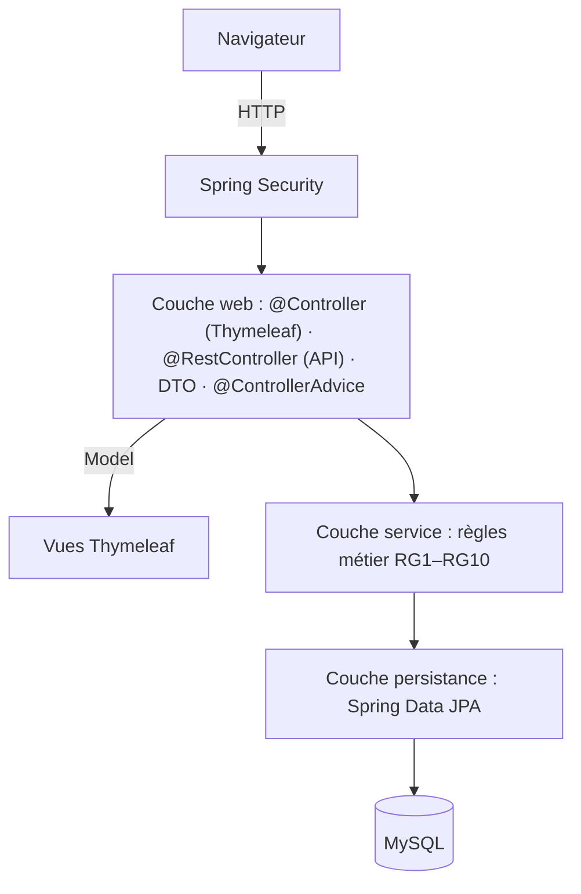

# Journal — Supervision ALTN72 (2026–27)

**Groupe :** à compléter

## README

- Prérequis : Java 21, Maven Wrapper et MySQL 8.4 installé localement
- Initialiser la base : créer la base MySQL `supervision` et configurer les variables d'environnement
- Lancer : `./mvnw spring-boot:run`
- Application déployée : à compléter
- Comptes de test : à compléter
- Limites connues : le dépôt contient actuellement le socle technique

## ARCHITECTURE

- Dépôt : https://github.com/ctpnheee/altn72-supervision
- Schéma et description détaillée : [docs/ARCHITECTURE.md](docs/ARCHITECTURE.md)
  (couches, packages, modèle de données, cycle de vie d'un incident, niveau d'attention, erreurs, sécurité, déploiement)

## TESTS

- Stratégie : tests unitaires métier, tests MVC et tests d'intégration à compléter progressivement
- Commande : `./mvnw verify`
- Couvert : chargement du contexte
- Non couvert : cas d'usage métier, encore non implémentés

## CHOIX TECHNIQUES

### Profils et droits

Deux profils : **RESPONSABLE** (responsable d'exploitation, vision globale) et **AGENT** (signale les pannes
sur le terrain). Toutes les restrictions sont appliquées côté serveur (RG11) : `requestMatchers` dans
`SecurityConfig` et `@PreAuthorize` sur les services ; masquer un bouton n'est qu'un confort.

| N° | Fonctionnalité | Profil 1 : RESPONSABLE | Profil 2 : AGENT |
|---|---|---|---|
| F2–F3 | Consulter équipements et fiches | Lecture seule | Lecture seule |
| F4 | Déclarer un incident | Accès complet | Accès complet |
| F5–F6 | Consulter / modifier un incident | Accès complet (description des incidents non résolus) | Lecture ; modification de la description de ses propres incidents non affectés |
| F7 | Affecter ou réaffecter un prestataire | Accès complet | Interdit |
| F8 | Déclarer un incident résolu | Accès complet | Interdit |
| F9 | Consulter l'historique | Lecture seule | Lecture seule |
| F10 | Évaluer un prestataire | Accès complet | Interdit |
| F11 | Tableau de bord | Accès complet | Interdit |
| F12 | API REST | Accès complet | Lecture seule |

Justification de F6 : l'agent qui a signalé une panne peut corriger sa description tant que personne ne l'a
prise en charge ; une fois l'incident affecté, seul le responsable la modifie, pour que le prestataire
travaille sur une information stable.

### Choix de conception validés (session de lancement du 28/10/2026)

- Un incident peut être résolu sans avoir été affecté (panne réglée en interne) ; il n'est alors pas
  évaluable, puisque RG8 exige un prestataire.
- Déclarer un incident passe l'équipement à `EN_PANNE` ; résoudre son dernier incident ouvert le repasse
  à `EN_SERVICE`. Ces opérations modifient deux entités et sont donc `@Transactional` (RG10).
- Le niveau d'attention (vert, orange, rouge, pris en charge) est calculé à la lecture à partir d'un
  `java.time.Clock` injecté ; il n'est jamais stocké.
- Organisation : pas de rôles figés, chacun s'assigne les tickets GitHub au fil de l'eau ; toute modification
  passe par une pull request dont la CI (`./mvnw verify`) doit être verte.

### Autres choix

- Exceptions : à choisir et justifier
- SOLID : à choisir, implémenter et justifier
- Requête SQL native : à ajouter une seule fois puis analyser
- `@Transactional` : à ajouter uniquement sur les opérations métier atomiques

## LOT ALPHA

### Fonctionnalité transverse 1 : à choisir

- Besoin, périmètre, essais, résultats et limites : à compléter

### Fonctionnalité transverse 2 : à choisir

- Besoin, périmètre, essais, résultats et limites : à compléter

## BILAN

- Contribution de chacun : à compléter
- Plus grande difficulté et solution : à compléter
- Fonctionnalités non réalisées et pourquoi : à compléter
- Trois points à retenir : à compléter
