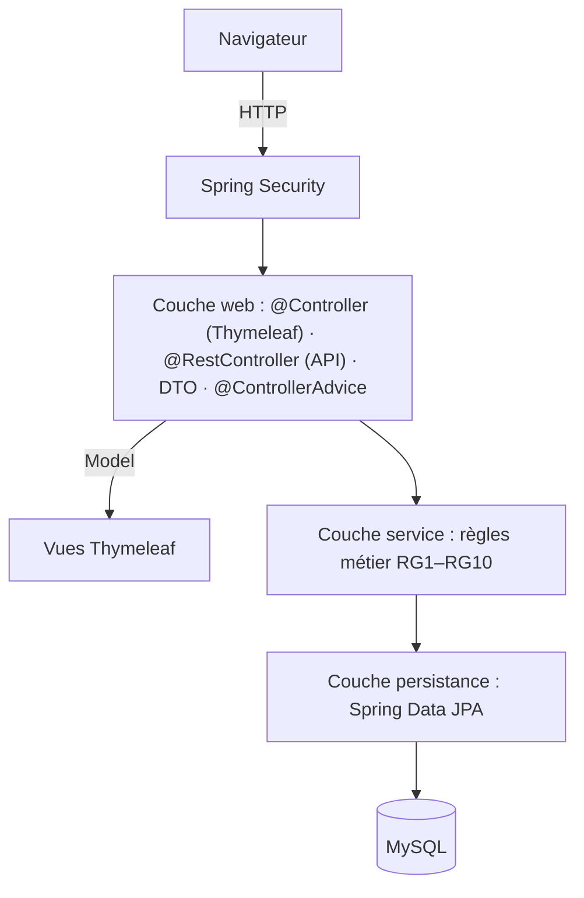

# Journal — Supervision ALTN72 (2026–27)

**Groupe :** à compléter

## README

- Prérequis : Java 21, Maven Wrapper et MySQL 8.4 installé localement
- Initialiser la base : créer la base MySQL `supervision` et configurer les variables d'environnement
- Lancer : `./mvnw spring-boot:run`
- Application déployée : https://supervision-elblh4yp7a-ew.a.run.app (Cloud Run, base Cloud SQL MySQL 8.4 ; redéployée automatiquement à chaque merge sur `main` par un déclencheur Cloud Build)
- Comptes de test : à compléter
- Limites connues : le dépôt contient actuellement le socle technique

## ARCHITECTURE

- Dépôt : https://github.com/ctpnheee/altn72-supervision
- Schéma et description détaillée : [docs/ARCHITECTURE.md](docs/ARCHITECTURE.md)
  (couches, packages, modèle de données, cycle de vie d'un incident, niveau d'attention, erreurs, sécurité, déploiement)

## TESTS

- Stratégie : tests unitaires métier, tests MVC et tests d'intégration à compléter progressivement
- Commande : `./mvnw verify`
- Couvert : chargement du contexte
- Non couvert : cas d'usage métier, encore non implémentés

## CHOIX TECHNIQUES

- Profils et droits : à définir avec le groupe avant d'implémenter F1
- Exceptions : à choisir et justifier
- SOLID : à choisir, implémenter et justifier
- Requête SQL native : à ajouter une seule fois puis analyser
- `@Transactional` : à ajouter uniquement sur les opérations métier atomiques

## LOT ALPHA

### Fonctionnalité transverse 1 : à choisir

- Besoin, périmètre, essais, résultats et limites : à compléter

### Fonctionnalité transverse 2 : à choisir

- Besoin, périmètre, essais, résultats et limites : à compléter

## BILAN

- Contribution de chacun : à compléter
- Plus grande difficulté et solution : à compléter
- Fonctionnalités non réalisées et pourquoi : à compléter
- Trois points à retenir : à compléter
