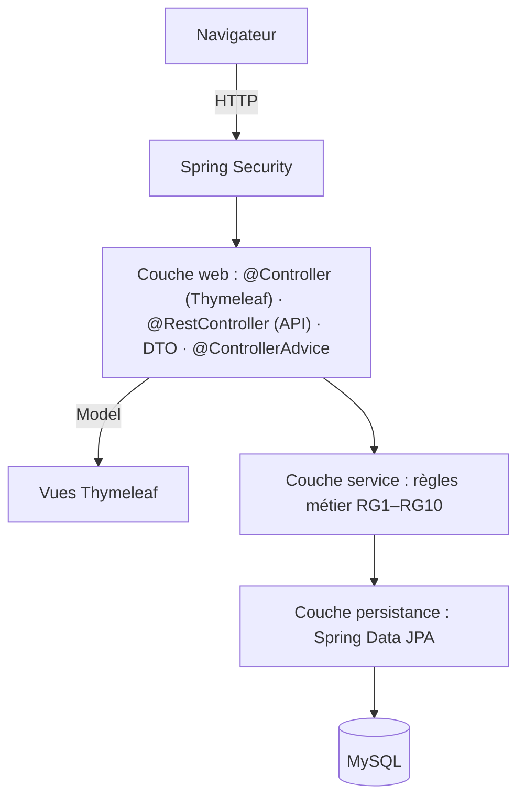

# Journal — Supervision ALTN72 (2026–27)

**Groupe :** Daphne et Jhermaine Crisostomo

## README

- Prérequis : Java 21, Maven Wrapper et MySQL 8.4 installé localement (avec MariaDB, voir le README du dépôt)
- Initialiser la base : créer la base et l'utilisateur MySQL `supervision` (commandes SQL dans `README.md`) ;
  les tables sont créées par Hibernate au premier lancement
- Lancer : `./mvnw spring-boot:run`, puis ouvrir http://localhost:8080 (connexion obligatoire)
- Application déployée : https://supervision-elblh4yp7a-ew.a.run.app (Cloud Run, base Cloud SQL MySQL 8.4 ; redéployée automatiquement à chaque merge sur `main` par un déclencheur Cloud Build)
- Comptes de test : `responsable` / `demo1234` (Alice, RESPONSABLE) et `agent` / `demo1234` (Bruno, AGENT)
- Données de démonstration : chargées au démarrage si la base est vide ; `APP_DEMO_RESET=true` les recrée datées de l'instant présent
- Limites connues : F1 à F12 sont en place, ainsi que les deux lots alpha (journal métier de l'incident, fenêtre modale d'affectation). Il n'y a pas d'inscription : les comptes viennent des données de démonstration. Hors de ce périmètre, rien n'est laissé ouvert dans le plan.

## ARCHITECTURE

- Dépôt : https://github.com/ctpnheee/altn72-supervision
- Schéma et description détaillée : [docs/ARCHITECTURE.md](docs/ARCHITECTURE.md)
  (couches, packages, modèle de données, cycle de vie d'un incident, niveau d'attention, erreurs, sécurité, déploiement)

## TESTS

- Stratégie : un test unitaire par règle métier (service, horloge fixe, dépôts simulés), un test MockMvc par page ou API, un `@DataJpaTest` quand l'ordre SQL ou une contrainte doit être vu en base. La base des tests est H2 en mode MySQL. La base MySQL locale ne sert pas à `./mvnw verify`.
- Commande : `./mvnw verify`
- Couvert :
  - F1 : visiteur non connecté renvoyé vers `/login`, mauvais mot de passe, déconnexion, agent interdit sur le tableau de bord
  - F2–F3 : liste des stations, équipements, fiche, incidents du plus récent au plus ancien
  - F4–F8 : déclaration, détail, durée avec horloge fixe, refus 403 d'un agent sur un incident affecté, affectation, résolution, équipement qui revient `EN_SERVICE`
  - F9 : ordre de l'historique en `@DataJpaTest`
  - F10 : refus si l'incident n'est pas résolu, refus si déjà évalué, note hors bornes, moyenne
  - F11 : incident résolu absent du tableau, filtres, agent → 403
  - F12 : 401 sans session, 404 incident inexistant, 409 transition interdite, lecture des prestataires réservée au responsable
  - B10 : deux incidents actifs à Châtelet, un à République, le résolu exclu. La même requête SQL, lancée sur la base locale, renvoie Châtelet 2, Gare de Lyon 3, République 3
  - Alpha 5 : affecter ou résoudre crée une ligne de journal (qui, quand, quoi), y compris via l'API
  - Alpha 6 : `GET /api/prestataires` testé en MockMvc. Le clic dans la fenêtre modale reste un essai manuel (voir LOT ALPHA 2)
- Non couvert par un test automatique : le parcours complet dans le navigateur (agent signale → responsable voit rouge → affecte dans la modale → résout → évalue) et l'affichage de l'URL Cloud Run depuis un autre ordinateur

## CHOIX TECHNIQUES

### Profils et droits

Deux profils : **RESPONSABLE** (responsable d'exploitation, vision globale) et **AGENT** (signale les pannes
sur le terrain). Toutes les restrictions sont appliquées côté serveur (RG11) : `requestMatchers` dans
`SecurityConfig` et `@PreAuthorize` sur les services ; masquer un bouton n'est qu'un confort.

| N° | Fonctionnalité | Profil 1 : RESPONSABLE | Profil 2 : AGENT |
|---|---|---|---|
| F2–F3 | Consulter équipements et fiches | Lecture seule | Lecture seule |
| F4 | Déclarer un incident | Accès complet | Accès complet |
| F5–F6 | Consulter / modifier un incident | Accès complet (description des incidents non résolus) | Lecture ; modification de la description de ses propres incidents non affectés |
| F7 | Affecter ou réaffecter un prestataire | Accès complet | Interdit |
| F8 | Déclarer un incident résolu | Accès complet | Interdit |
| F9 | Consulter l'historique | Lecture seule | Lecture seule |
| F10 | Évaluer un prestataire | Accès complet | Interdit |
| F11 | Tableau de bord | Accès complet | Interdit |
| F12 | API REST | Accès complet | Lecture seule |

Justification de F6 : l'agent qui a signalé une panne peut corriger sa description tant que personne ne l'a
prise en charge ; une fois l'incident affecté, seul le responsable la modifie, pour que le prestataire
travaille sur une information stable.

### Choix de conception validés

- Un incident peut être résolu sans avoir été affecté (panne réglée en interne) ; il n'est alors pas
  évaluable, puisque RG8 exige un prestataire.
- Déclarer un incident passe l'équipement à `EN_PANNE` ; résoudre son dernier incident ouvert le repasse
  à `EN_SERVICE`. Ces opérations modifient deux entités et sont donc `@Transactional` (RG10).
- Le niveau d'attention (vert, orange, rouge, pris en charge) est calculé à la lecture à partir d'un
  `java.time.Clock` injecté ; il n'est jamais stocké.
- Organisation : pas de rôles figés, chacun s'assigne les tickets GitHub au fil de l'eau ; toute modification
  passe par une pull request dont la CI (`./mvnw verify`) doit être verte.

### Autres choix

- Exceptions : exceptions métier dans `exception/` (`RessourceIntrouvableException`,
  `TransitionInterditeException`, `EvaluationDejaSaisieException`), avec un message en français, traduites
  en réponses `ProblemDetail` par un `@RestControllerAdvice` (`api/ApiExceptionHandler`) : 404 ressource
  introuvable, 409 transition interdite ou évaluation déjà saisie, 400 donnée invalide (avec le champ en cause).
  Choix de `@ControllerAdvice` plutôt que `ResponseStatusException` :
  - la traduction vers HTTP est écrite à un seul endroit ; changer un code ou un format de message ne touche
    qu'une classe ;
  - les services ignorent HTTP (règle de dépendance de la couche service) : ils lèvent une exception qui dit
    ce qui s'est passé, sans choisir de code, et restent testables sans contexte web ;
  - avec `ResponseStatusException`, chaque service devrait connaître les codes HTTP et ses messages seraient
    dispersés dans tout le code ;
  - une même exception métier peut être traduite différemment selon l'origine : JSON pour l'API, page ou
    message flash pour les pages (ticket B3).
  Aucune trace technique n'est renvoyée : seul le message en français l'est. Pas de `catch` vide.
- SOLID :
  - Responsabilité unique, appliquée : `JournalIncident` écrit l'historique, `IncidentService` décide des transitions, `NiveauAttentionCalculator` calcule le niveau. Changer le texte d'une ligne de journal ne modifie pas `affecter`.
  - Ouvert / fermé, appliqué : `IncidentService` publie `EvenementIncidentDemande`. Un nouvel écouteur s'ajoute sans modifier `affecter` ni `resoudre`. C'est le choix retenu pour le lot alpha, plutôt qu'un appel direct à `EvenementIncidentRepository` dans le service.
  - Inversion des dépendances, appliquée : les services reçoivent `Clock` et les dépôts par constructeur. Un test passe une horloge fixe et des simulacres, sans base ni heure réelle.
  - Écarté : une interface Java devant chaque service. Les dépôts sont déjà des interfaces Spring Data. Une interface de plus par service n'aurait servi à aucun second implémenteur.
- Requête SQL native (B10) : une seule, `IncidentRepository.compterIncidentsActifsParStation`, déclarée avec `@Query(nativeQuery = true)`. Elle compte les incidents non résolus par station pour l'indicateur « Incidents actifs par station » du tableau de bord (F11).
  - Fonctionnement : les tables `incident`, `equipement` et `station` sont reliées par `equipement_id` et `station_id`. Le filtre `statut <> 'RESOLU'` écarte les incidents résolus. `GROUP BY s.id, s.nom` et `COUNT(i.id)` produisent le total, trié par nom de station. Le résultat arrive au service par la projection `IncidentsActifsParStation`. `TableauDeBordService` la transforme en `StatistiqueStation`. Le contrôleur et le template n'ont pas de SQL.
  - Avantages : le regroupement et le comptage sont faits par le SGBD. Les entités ne sont pas chargées en mémoire pour cette statistique. `JOIN`, `COUNT`, `GROUP BY` et `ORDER BY` sont du SQL courant, commun à MySQL et à H2.
  - Limites : la chaîne dépend des noms physiques (`incident`, `equipement`, `station`, `equipement_id`, `station_id`). Le compilateur Java ne la vérifie pas : une colonne renommée ne casse qu'à l'exécution. Le filtre « non résolu » doit rester le même que dans les autres lectures d'incidents actifs.
  - Pourquoi ici : l'agrégation s'exécute en base. La même statistique pourrait s'écrire en JPQL. Le SQL natif n'est pas indispensable pour ce calcul ; il répond à l'exigence de n'en avoir qu'un, et de l'analyser.
  - Essai : `@DataJpaTest` sur H2 (`IncidentRepositoryTest.requeteNativeCompteLesIncidentsActifsParStation`). La même requête, exécutée sur la base locale de l'application, renvoie Châtelet 2, Gare de Lyon 3, République 3. Les incidents `RESOLU` n'entrent pas dans ces totaux.
- `@Transactional` : posé sur `IncidentService.declarer`, qui enregistre l'incident et passe l'équipement
  à `EN_PANNE` dans la même transaction (RG10).
  Posé aussi sur `modifierDescription` : le contrôle du droit relit le statut et le déclarant, puis écrit
  la description. Sans cette transaction, une affectation intercalée laisserait enregistrer la correction d'un agent.
  `consulter` est en lecture seule : `open-in-view` est désactivé, et le détail doit lire l'incident, le prestataire
  et l'évaluation dans la même vue.
  Posé sur `affecter` pour la même raison : sans transaction, l'incident chargé est détaché et `save` réécrit
  toute la ligne. Une résolution enregistrée entre-temps serait écrasée.
  Posé sur `resoudre` : l'incident passe à `RESOLU` et, s'il était le dernier incident ouvert de l'équipement,
  l'équipement repasse `EN_SERVICE`. Les deux écritures doivent réussir ou échouer ensemble (RG10). Sans cela,
  l'équipement peut rester `EN_PANNE` après une résolution réussie, ou `EN_SERVICE` après une résolution annulée.
- Durée d'ouverture (F5) : calculée dans `IncidentService` avec le `Clock` injecté (incident ouvert : maintenant −
  ouverture ; incident résolu : résolution − ouverture). La vue reçoit une chaîne déjà prête. Sans cela, le template
  comparerait des dates, ce que l'architecture interdit, et un test ne pourrait pas fixer l'instant.
- Droit de modifier la description (F6, RG11) : `@PreAuthorize` sur `modifierDescription` et
  `controlerDroitModification`, délégué à `AutorisationsIncident`. Un `requestMatchers` ne distingue pas un incident
  affecté d'un incident ouvert. Masquer le formulaire ne suffit pas : un POST direct d'un agent sur un incident
  affecté répond 403. La même règle est rejouée dans la transaction, pour le cas où l'incident est affecté entre
  le contrôle de sécurité et l'écriture.
- Affectation et résolution (F7, F8, RG5, RG10, RG11) :
  - Le décompte des incidents encore ouverts est fait avant de passer le statut à `RESOLU`. Sinon Hibernate
    vide le contexte avant la requête et oublie l'incident en cours : l'équipement resterait `EN_PANNE`.
  - L'instant de résolution vient du `Clock` injecté, pas d'un champ du formulaire. L'architecture expose
    `resoudre(id)`. Un test fixe l'horloge avant l'ouverture et vérifie le refus (la date doit être ≥ l'ouverture).
  - La règle vit dans le service. Le contrôleur valide `AffectationForm`, appelle le service et choisit la vue
    ou la redirection. La vue ne compare pas le statut : elle affiche les formulaires seulement si
    `peutAffecterOuResoudre` est vrai, avec un libellé déjà choisi (`Affecter` ou `Réaffecter`).
  - `@Valid` sur `AffectationForm`, message « Choisissez un prestataire. » Un formulaire invalide est réaffiché.
    Avant de le réafficher, `controlerDroitPilotage` vérifie le rôle : un agent qui envoie une liste vide reçoit
    403, pas le formulaire.
  - Un incident résolu lève `TransitionInterditeException` (« Un incident résolu ne peut plus être réaffecté. »,
    « Cet incident est déjà résolu. »). Le gestionnaire pose le message en flash et renvoie à la page d'origine.
  - `@PreAuthorize("hasRole('RESPONSABLE')")` sur `affecter`, `resoudre` et `controlerDroitPilotage`. Un
    `requestMatchers` sur ces POST empêcherait aussi l'agent d'ouvrir le détail, puisque l'URL du détail est
    la même page. Masquer le bouton ne suffit pas (RG11) : un POST direct d'un agent répond 403.
  - `PrestataireRepository` est reçu par le constructeur, avec les autres dépôts et le `Clock` : un test unitaire
    passe des simulacres et une horloge fixe.
- API des incidents (F12) :
  - `IncidentApiController` ne recalcule pas les règles. `PUT` appelle `affecter` et `PATCH` appelle `resoudre`,
    les mêmes méthodes que les pages. Sans cela, la date, l'interdiction de réaffecter un incident résolu et le
    retour en service de l'équipement existeraient deux fois et pourraient diverger.
  - Le JSON est un `IncidentResume` : les deux profils reçoivent les mêmes champs. Le droit d'écrire reste
    `@PreAuthorize("hasRole('RESPONSABLE')")` sur le service (RG11). Un agent qui envoie un `PUT` reçoit 403.
  - Sans session, `/api/**` répond 401. Les pages continuent de rediriger vers `/login`. Les deux comportements sont
    deux correspondances dans `SecurityConfig` : avec une seule, Spring Security l'appliquerait à toutes les requêtes.
  - Les erreurs métier passent par `ApiExceptionHandler` en `ProblemDetail` : 404 ressource introuvable, 409
    transition interdite, 400 corps invalide, avec le champ en cause. Aucune trace technique.
  - Le jeton CSRF des formulaires reste exigé sur `PUT` et `PATCH`. La session est un cookie : sans ce jeton, un
    autre site pourrait affecter un prestataire pendant que l'utilisateur est connecté.
  - Swagger (springdoc) ne décrit que le package `api`. Les contrôleurs de pages renvoient un nom de vue, pas du JSON.
    La page est `/swagger-ui.html`, après connexion.
- Journal métier d'un incident :
  - `IncidentService` publie `EvenementIncidentDemande` après un enregistrement réussi. `JournalIncident` écoute et
    écrit la ligne. Le service ne connaît pas la table : un autre écouteur peut s'ajouter sans modifier `affecter`.
  - L'écoute est synchrone et `@Transactional`, donc elle rejoint la transaction de `affecter` ou `resoudre`.
    Après le commit, un échec du journal laisserait un incident sans sa ligne.
  - La date vient du `Clock` de l'écouteur. Le formulaire n'a pas de champ « quand ».
  - Le contrôleur passe le login. Le service ne lit pas le `SecurityContext` : un test unitaire publie l'événement
    sans contexte de sécurité. Le prénom affiché (« Alice ») est résolu dans l'écouteur.
  - La page reçoit `List<EvenementLigne>` déjà ordonnée (date, puis identifiant). La vue n'ordonne pas les dates.
- Durcissement (A10) :
  - `Incident.DESCRIPTION_MAX` est la borne de la colonne et des deux formulaires de description. Deux nombres
    différents laisseraient passer une saisie que la base refuse, ou l'inverse.
  - « Incident 4 introuvable. » est construit par `RessourceIntrouvableException.pour`. Le service, le journal et
    l'évaluation utilisent la même phrase. Une copie divergente ferait diverger le 404 de la page et celui de l'API.
  - La précision de durée et les libellés « Affecter » / « Réaffecter » sont des constantes du service, reprises
    par la page et le JSON. La vue ne les recalcule pas.
  - La page et l'API ont chacune la constante « Choisissez un prestataire. ». L'une ne référence pas l'autre :
    un DTO de page ne dépend pas du JSON, et l'inverse non plus.
  - `xmlns:sec` du détail pointait vers le namespace XHTML, donc `sec:authorize` n'était pas lu. Le formulaire
    d'évaluation s'affichait aussi pour un agent. Le namespace est celui de Spring Security, comme dans le layout.
  - Les tests couvrent la ligne de réaffectation, la ligne de résolution, et les lignes créées par l'API. Sans eux,
    un oubli de `publier` après `resoudre` laisserait `./mvnw verify` vert.

## LOT ALPHA

### Fonctionnalité transverse 1 : journal métier d'un incident (piste 5)

- Besoin : retrouver qui a affecté ou résolu un incident, et quand, sans relire le code.
- Périmètre : une entité `EvenementIncident` (incident, date, auteur, action). `IncidentService` publie `EvenementIncidentDemande` après `declarer`, `affecter` et `resoudre`. `JournalIncident` écoute et enregistre la ligne dans la même transaction. Le détail de l'incident affiche les lignes de la plus ancienne à la plus récente.
- Essais : un test unitaire vérifie que l'événement part après l'enregistrement. `JournalIncidentWebTest` vérifie qu'une affectation et une résolution, y compris par l'API, laissent une ligne avec l'auteur et l'action.
- Résultat : le détail montre l'historique. La date vient du `Clock` de l'écouteur, pas d'un champ saisi.
- Limite : l'écoute est synchrone. Si l'écriture de la ligne échoue, la transition est annulée avec elle. Un journal ajouté après le commit aurait pu perdre la ligne.

### Fonctionnalité transverse 2 : fenêtre modale d'affectation (piste 6)

- Besoin : affecter un prestataire depuis le tableau de bord ou le détail, et voir le badge passer à « Pris en charge » sans recharger la page.
- Périmètre : `affectation-modale.js` ouvre la fenêtre, charge `GET /api/prestataires`, puis envoie `PUT /api/incidents/{id}/prestataire` avec le jeton CSRF de la session. La réponse met à jour le statut, le badge et le bloc prestataire déjà présents dans la page. Le formulaire classique reste en place si JavaScript est absent.
- Essais : `PrestataireApiWebTest` vérifie que l'agent reçoit 403 sur `GET /api/prestataires` et que le responsable reçoit la liste. L'affectation elle-même réutilise `IncidentService.affecter`, déjà testé. Essai manuel : se connecter avec `responsable` / `demo1234`, ouvrir un incident non affecté en rouge, cliquer sur « Affecter », choisir un prestataire, confirmer. Le badge devient « Pris en charge » et le nom du prestataire apparaît, l'adresse de la page ne change pas.
- Résultat : le responsable affecte sans quitter le tableau de bord.
- Limite : le script ne couvre pas la résolution ni l'évaluation. Ces deux actions restent des formulaires qui rechargent la page. Un agent ne voit pas le bouton : le droit est aussi refusé par `@PreAuthorize` sur l'API.

## BILAN

- Contribution de chacun, d'après les commits :
  - Daphne : socle (entités, exceptions, données de démonstration, connexion, layout, pages d'erreur), puis le cycle d'un incident (déclarer, consulter, modifier, affecter, résoudre), l'API et le journal métier.
  - Jhermaine Crisostomo : horloge et niveau d'attention, consultation des équipements, historique, évaluation, fiches prestataires, tableau de bord, requête SQL native, fenêtre modale d'affectation.
  - Les fusions sur `main` sont faites depuis le compte qui porte les pull requests. Chacun relit la pull request de l'autre.
- Plus grande difficulté et solution : faire revenir l'équipement `EN_SERVICE` au moment où son dernier incident ouvert est résolu. Les deux écritures doivent réussir ensemble (RG10). En comptant les incidents ouverts après avoir déjà marqué l'incident `RESOLU`, Hibernate vidait le contexte et oubliait la modification en cours : l'équipement restait `EN_PANNE`. Le décompte est fait avant le changement de statut, et `resoudre` est `@Transactional`.
- Fonctionnalités non réalisées et pourquoi : aucune des fonctionnalités F1 à F12, ni les deux lots alpha. L'inscription d'un compte n'est pas au sujet : les deux comptes de démonstration suffisent. La fenêtre modale ne résout pas et n'évalue pas ; ces actions restent des formulaires, le sujet ne demandait l'enrichissement que pour l'affectation.
- Trois points à retenir :
  - La règle métier est dans le service. Le contrôleur valide, appelle, et choisit la page. Masquer un bouton ne remplace pas `@PreAuthorize` (RG11).
  - L'heure vient du `Clock` injecté. Un test fixe 47 h, 48 h et 72 h sans attendre en vrai.
  - Une seule requête SQL native, pour l'agrégation par station. Le reste passe par Spring Data, pour ne pas coller tout le code aux noms des colonnes.

## Échange de code

Préparation à l'oral, chacun sur une partie qu'il n'a pas écrite :

- Daphne présente le tableau de bord et la requête native : `TableauDeBordService` filtre les incidents non résolus, `IncidentRepository.compterIncidentsActifsParStation` compte par station, la vue n'a pas de SQL.
- Jhermaine présente le journal métier : `IncidentService` publie `EvenementIncidentDemande`, `JournalIncident` enregistre la ligne dans la même transaction, le détail affiche les lignes déjà triées.
