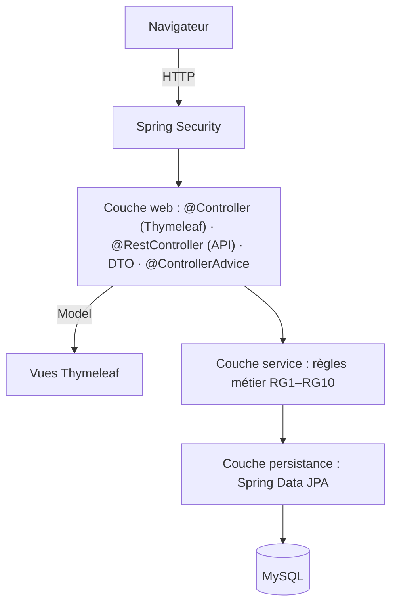

# Journal — Supervision ALTN72 (2026–27)

**Groupe :** à compléter

## README

- Prérequis : Java 21, Maven Wrapper et MySQL 8.4 installé localement (avec MariaDB, voir le README du dépôt)
- Initialiser la base : créer la base et l'utilisateur MySQL `supervision` (commandes SQL dans `README.md`) ;
  les tables sont créées par Hibernate au premier lancement
- Lancer : `./mvnw spring-boot:run`, puis ouvrir http://localhost:8080 (connexion obligatoire)
- Application déployée : https://supervision-elblh4yp7a-ew.a.run.app (Cloud Run, base Cloud SQL MySQL 8.4 ; redéployée automatiquement à chaque merge sur `main` par un déclencheur Cloud Build)
- Comptes de test : `responsable` / `demo1234` (Alice, RESPONSABLE) et `agent` / `demo1234` (Bruno, AGENT)
- Données de démonstration : chargées au démarrage si la base est vide ; `APP_DEMO_RESET=true` les recrée datées de l'instant présent
- Limites connues : F1 à F12 et le journal métier d'un incident sont disponibles ; la fenêtre modale d'affectation (alpha 6) reste à faire

## ARCHITECTURE

- Dépôt : https://github.com/ctpnheee/altn72-supervision
- Schéma et description détaillée : [docs/ARCHITECTURE.md](docs/ARCHITECTURE.md)
  (couches, packages, modèle de données, cycle de vie d'un incident, niveau d'attention, erreurs, sécurité, déploiement)

## TESTS

- Stratégie : tests unitaires métier, tests MVC et tests d'intégration à compléter progressivement
- Commande : `./mvnw verify`
- Couvert : chargement du contexte
- Non couvert : cas d'usage métier, encore non implémentés

## CHOIX TECHNIQUES

### Profils et droits

Deux profils : **RESPONSABLE** (responsable d'exploitation, vision globale) et **AGENT** (signale les pannes
sur le terrain). Toutes les restrictions sont appliquées côté serveur (RG11) : `requestMatchers` dans
`SecurityConfig` et `@PreAuthorize` sur les services ; masquer un bouton n'est qu'un confort.

| N° | Fonctionnalité | Profil 1 : RESPONSABLE | Profil 2 : AGENT |
|---|---|---|---|
| F2–F3 | Consulter équipements et fiches | Lecture seule | Lecture seule |
| F4 | Déclarer un incident | Accès complet | Accès complet |
| F5–F6 | Consulter / modifier un incident | Accès complet (description des incidents non résolus) | Lecture ; modification de la description de ses propres incidents non affectés |
| F7 | Affecter ou réaffecter un prestataire | Accès complet | Interdit |
| F8 | Déclarer un incident résolu | Accès complet | Interdit |
| F9 | Consulter l'historique | Lecture seule | Lecture seule |
| F10 | Évaluer un prestataire | Accès complet | Interdit |
| F11 | Tableau de bord | Accès complet | Interdit |
| F12 | API REST | Accès complet | Lecture seule |

Justification de F6 : l'agent qui a signalé une panne peut corriger sa description tant que personne ne l'a
prise en charge ; une fois l'incident affecté, seul le responsable la modifie, pour que le prestataire
travaille sur une information stable.

### Choix de conception validés

- Un incident peut être résolu sans avoir été affecté (panne réglée en interne) ; il n'est alors pas
  évaluable, puisque RG8 exige un prestataire.
- Déclarer un incident passe l'équipement à `EN_PANNE` ; résoudre son dernier incident ouvert le repasse
  à `EN_SERVICE`. Ces opérations modifient deux entités et sont donc `@Transactional` (RG10).
- Le niveau d'attention (vert, orange, rouge, pris en charge) est calculé à la lecture à partir d'un
  `java.time.Clock` injecté ; il n'est jamais stocké.
- Organisation : pas de rôles figés, chacun s'assigne les tickets GitHub au fil de l'eau ; toute modification
  passe par une pull request dont la CI (`./mvnw verify`) doit être verte.

### Autres choix

- Exceptions : exceptions métier dans `exception/` (`RessourceIntrouvableException`,
  `TransitionInterditeException`, `EvaluationDejaSaisieException`), avec un message en français, traduites
  en réponses `ProblemDetail` par un `@RestControllerAdvice` (`api/ApiExceptionHandler`) : 404 ressource
  introuvable, 409 transition interdite ou évaluation déjà saisie, 400 donnée invalide (avec le champ en cause).
  Choix de `@ControllerAdvice` plutôt que `ResponseStatusException` :
  - la traduction vers HTTP est écrite à un seul endroit ; changer un code ou un format de message ne touche
    qu'une classe ;
  - les services ignorent HTTP (règle de dépendance de la couche service) : ils lèvent une exception qui dit
    ce qui s'est passé, sans choisir de code, et restent testables sans contexte web ;
  - avec `ResponseStatusException`, chaque service devrait connaître les codes HTTP et ses messages seraient
    dispersés dans tout le code ;
  - une même exception métier peut être traduite différemment selon l'origine : JSON pour l'API, page ou
    message flash pour les pages (ticket B3).
  Aucune trace technique n'est renvoyée : seul le message en français l'est. Pas de `catch` vide.
- SOLID : à choisir, implémenter et justifier
- Requête SQL native : à ajouter une seule fois puis analyser
- `@Transactional` : posé sur `IncidentService.declarer`, qui enregistre l'incident et passe l'équipement
  à `EN_PANNE` dans la même transaction (RG10).
  Posé aussi sur `modifierDescription` : le contrôle du droit relit le statut et le déclarant, puis écrit
  la description. Sans cette transaction, une affectation intercalée laisserait enregistrer la correction d'un agent.
  `consulter` est en lecture seule : `open-in-view` est désactivé, et le détail doit lire l'incident, le prestataire
  et l'évaluation dans la même vue.
  Posé sur `affecter` pour la même raison : sans transaction, l'incident chargé est détaché et `save` réécrit
  toute la ligne. Une résolution enregistrée entre-temps serait écrasée.
  Posé sur `resoudre` : l'incident passe à `RESOLU` et, s'il était le dernier incident ouvert de l'équipement,
  l'équipement repasse `EN_SERVICE`. Les deux écritures doivent réussir ou échouer ensemble (RG10). Sans cela,
  l'équipement peut rester `EN_PANNE` après une résolution réussie, ou `EN_SERVICE` après une résolution annulée.
- Durée d'ouverture (F5) : calculée dans `IncidentService` avec le `Clock` injecté (incident ouvert : maintenant −
  ouverture ; incident résolu : résolution − ouverture). La vue reçoit une chaîne déjà prête. Sans cela, le template
  comparerait des dates, ce que l'architecture interdit, et un test ne pourrait pas fixer l'instant.
- Droit de modifier la description (F6, RG11) : `@PreAuthorize` sur `modifierDescription` et
  `controlerDroitModification`, délégué à `AutorisationsIncident`. Un `requestMatchers` ne distingue pas un incident
  affecté d'un incident ouvert. Masquer le formulaire ne suffit pas : un POST direct d'un agent sur un incident
  affecté répond 403. La même règle est rejouée dans la transaction, pour le cas où l'incident est affecté entre
  le contrôle de sécurité et l'écriture.
- Affectation et résolution (F7, F8, RG5, RG10, RG11) :
  - Le décompte des incidents encore ouverts est fait avant de passer le statut à `RESOLU`. Sinon Hibernate
    vide le contexte avant la requête et oublie l'incident en cours : l'équipement resterait `EN_PANNE`.
  - L'instant de résolution vient du `Clock` injecté, pas d'un champ du formulaire. L'architecture expose
    `resoudre(id)`. Un test fixe l'horloge avant l'ouverture et vérifie le refus (la date doit être ≥ l'ouverture).
  - La règle vit dans le service. Le contrôleur valide `AffectationForm`, appelle le service et choisit la vue
    ou la redirection. La vue ne compare pas le statut : elle affiche les formulaires seulement si
    `peutAffecterOuResoudre` est vrai, avec un libellé déjà choisi (`Affecter` ou `Réaffecter`).
  - `@Valid` sur `AffectationForm`, message « Choisissez un prestataire. » Un formulaire invalide est réaffiché.
    Avant de le réafficher, `controlerDroitPilotage` vérifie le rôle : un agent qui envoie une liste vide reçoit
    403, pas le formulaire.
  - Un incident résolu lève `TransitionInterditeException` (« Un incident résolu ne peut plus être réaffecté. »,
    « Cet incident est déjà résolu. »). Le gestionnaire pose le message en flash et renvoie à la page d'origine.
  - `@PreAuthorize("hasRole('RESPONSABLE')")` sur `affecter`, `resoudre` et `controlerDroitPilotage`. Un
    `requestMatchers` sur ces POST empêcherait aussi l'agent d'ouvrir le détail, puisque l'URL du détail est
    la même page. Masquer le bouton ne suffit pas (RG11) : un POST direct d'un agent répond 403.
  - `PrestataireRepository` est reçu par le constructeur, avec les autres dépôts et le `Clock` : un test unitaire
    passe des simulacres et une horloge fixe.
- API des incidents (F12) :
  - `IncidentApiController` ne recalcule pas les règles. `PUT` appelle `affecter` et `PATCH` appelle `resoudre`,
    les mêmes méthodes que les pages. Sans cela, la date, l'interdiction de réaffecter un incident résolu et le
    retour en service de l'équipement existeraient deux fois et pourraient diverger.
  - Le JSON est un `IncidentResume` : les deux profils reçoivent les mêmes champs. Le droit d'écrire reste
    `@PreAuthorize("hasRole('RESPONSABLE')")` sur le service (RG11). Un agent qui envoie un `PUT` reçoit 403.
  - Sans session, `/api/**` répond 401. Les pages continuent de rediriger vers `/login`. Les deux comportements sont
    deux correspondances dans `SecurityConfig` : avec une seule, Spring Security l'appliquerait à toutes les requêtes.
  - Les erreurs métier passent par `ApiExceptionHandler` en `ProblemDetail` : 404 ressource introuvable, 409
    transition interdite, 400 corps invalide, avec le champ en cause. Aucune trace technique.
  - Le jeton CSRF des formulaires reste exigé sur `PUT` et `PATCH`. La session est un cookie : sans ce jeton, un
    autre site pourrait affecter un prestataire pendant que l'utilisateur est connecté.
  - Swagger (springdoc) ne décrit que le package `api`. Les contrôleurs de pages renvoient un nom de vue, pas du JSON.
    La page est `/swagger-ui.html`, après connexion.
- Journal métier d'un incident :
  - `IncidentService` publie `EvenementIncidentDemande` après un enregistrement réussi. `JournalIncident` écoute et
    écrit la ligne. Le service ne connaît pas la table : un autre écouteur peut s'ajouter sans modifier `affecter`.
  - L'écoute est synchrone et `@Transactional`, donc elle rejoint la transaction de `affecter` ou `resoudre`.
    Après le commit, un échec du journal laisserait un incident sans sa ligne.
  - La date vient du `Clock` de l'écouteur. Le formulaire n'a pas de champ « quand ».
  - Le contrôleur passe le login. Le service ne lit pas le `SecurityContext` : un test unitaire publie l'événement
    sans contexte de sécurité. Le prénom affiché (« Alice ») est résolu dans l'écouteur.
  - La page reçoit `List<EvenementLigne>` déjà ordonnée (date, puis identifiant). La vue n'ordonne pas les dates.
- Durcissement (A10) :
  - `Incident.DESCRIPTION_MAX` est la borne de la colonne et des deux formulaires de description. Deux nombres
    différents laisseraient passer une saisie que la base refuse, ou l'inverse.
  - « Incident 4 introuvable. » est construit par `RessourceIntrouvableException.pour`. Le service, le journal et
    l'évaluation utilisent la même phrase. Une copie divergente ferait diverger le 404 de la page et celui de l'API.
  - La précision de durée et les libellés « Affecter » / « Réaffecter » sont des constantes du service, reprises
    par la page et le JSON. La vue ne les recalcule pas.
  - La page et l'API ont chacune la constante « Choisissez un prestataire. ». L'une ne référence pas l'autre :
    un DTO de page ne dépend pas du JSON, et l'inverse non plus.
  - `xmlns:sec` du détail pointait vers le namespace XHTML, donc `sec:authorize` n'était pas lu. Le formulaire
    d'évaluation s'affichait aussi pour un agent. Le namespace est celui de Spring Security, comme dans le layout.
  - Les tests couvrent la ligne de réaffectation, la ligne de résolution, et les lignes créées par l'API. Sans eux,
    un oubli de `publier` après `resoudre` laisserait `./mvnw verify` vert.

## LOT ALPHA

### Fonctionnalité transverse 1 : à choisir

- Besoin, périmètre, essais, résultats et limites : à compléter

### Fonctionnalité transverse 2 : à choisir

- Besoin, périmètre, essais, résultats et limites : à compléter

## BILAN

- Contribution de chacun : à compléter
- Plus grande difficulté et solution : à compléter
- Fonctionnalités non réalisées et pourquoi : à compléter
- Trois points à retenir : à compléter
